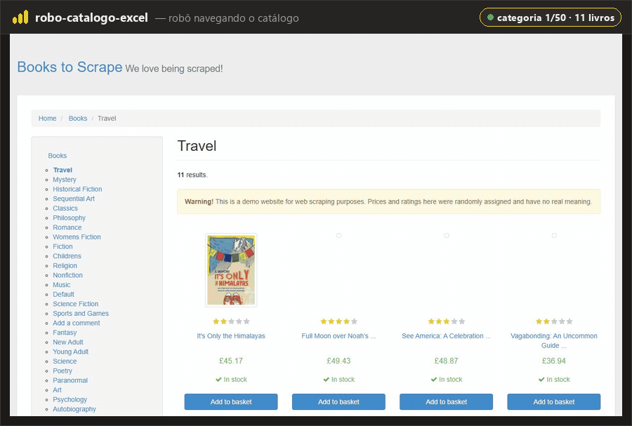
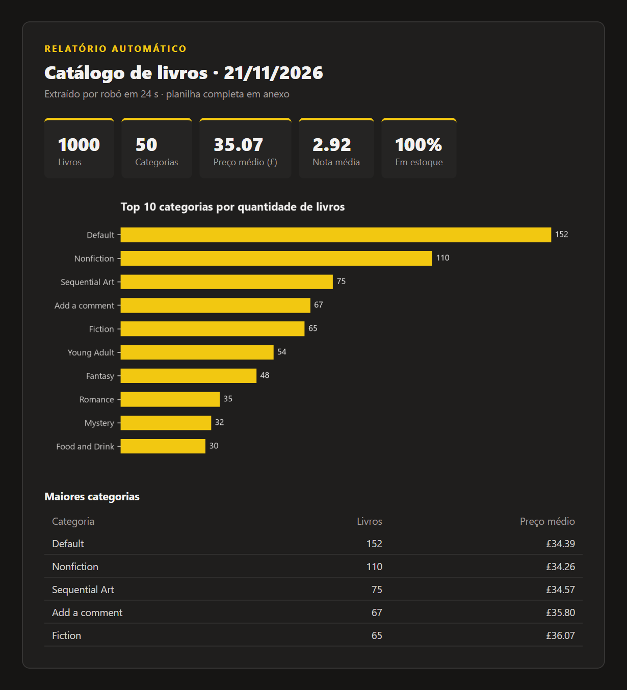

# 📚 Robô de catálogo → relatório Excel + e-mail

RPA em Python que navega um catálogo web inteiro como um usuário faria (categoria por categoria,
seguindo a paginação), consolida os dados e entrega um **relatório Excel pronto** com gráficos nativos,
além de um **e-mail HTML** com o resumo e a planilha em anexo.

Fonte: [books.toscrape.com](https://books.toscrape.com), catálogo público feito para treinar extração de dados.

<p align="center">
  
</p>

| Execução | |
|---|---|
| Livros extraídos | **1.000** |
| Categorias | **50** |
| Tempo total | **~24 s** (headless) |
| Saídas | `catalogo.xlsx`, `email.html`, `livros.csv`, `grafico.png` |

## O que sai do robô

**Excel (`catalogo.xlsx`)**
- Aba **Resumo**: KPIs, tabela por categoria com barras de dados e escala de cores, gráfico de barras (top 10) e pizza de notas, tudo nativo do Excel (openpyxl).
- Aba **Livros**: os 1.000 registros como Tabela do Excel com filtro, link para cada página, nota em estrelas e escala de cor no preço.

**E-mail (`email.html`)** — resumo com KPIs, gráfico e maiores categorias. Com `--enviar` ele vai por SMTP com a planilha anexada:

<p align="center">
  
</p>

## Rodando

```bash
pip install -r requirements.txt
playwright install chromium
python robo.py                 # extrai e gera os arquivos em saida/
python robo.py --demo          # também salva os quadros da navegação
SMTP_USER=... SMTP_SENHA=... EMAIL_PARA=... python robo.py --enviar
```

## Estrutura

```text
robo.py        # navegação e extração (Playwright), envio por SMTP
relatorio.py   # Excel (openpyxl), gráfico (matplotlib) e HTML do e-mail
tests/         # testes de parsing e do relatório
```

## Stack

Python · Playwright · pandas · openpyxl · matplotlib · SMTP · pytest · GitHub Actions
